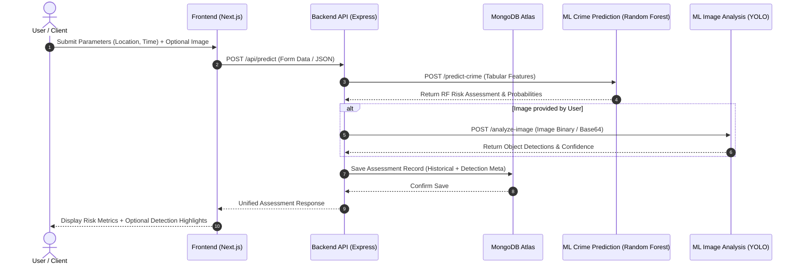

# CrimePulse System Architecture 🏛️

This document outlines the software architecture and component design for **CrimePulse**, a production-style academic ML web application for crime pattern forecasting and visual object analysis.

---

## 📂 Project Directory Layout

```text
CrimePulse
├── frontend/                     # React / Next.js UI with Tailwind CSS
│   └── .gitkeep
├── backend/                      # Node.js / Express.js REST API Gateway
│   └── .gitkeep
├── ml-service/                   # Python FastAPI ML Services
│   ├── crime-prediction/        # Historical Crime Pattern Prediction (Random Forest)
│   │   └── .gitkeep
│   └── image-analysis/          # Visual Object Detection (YOLO - Optional)
│       └── .gitkeep
├── docs/                         # Project Documentation & Architecture Guides
│   └── .gitkeep
├── .gitignore                    # Version control ignore definitions
├── ARCHITECTURE.md               # Architectural specification (this document)
└── README.md                     # Root project overview
```

---

## 🧩 Component Responsibilities

### 1. Frontend (`frontend/`)
* **Technology**: React, Next.js, Tailwind CSS.
* **Role**:
  * Renders dynamic user interface for entering location, time, and situational parameters.
  * Provides optional file upload component for image scene analysis.
  * Displays historical risk prediction metrics alongside optional visual object detection results.

### 2. Backend API Gateway (`backend/`)
* **Technology**: Node.js, Express.js, Mongoose / MongoDB Native Driver.
* **Role**:
  * Central REST API orchestrator and security boundary.
  * Handles request validation, user session/history persistence, and logging.
  * Proxies prediction requests to `ml-service/crime-prediction` and image analysis requests to `ml-service/image-analysis`.
  * Merges historical prediction outputs and image detection outputs into unified client responses.
  * Connects to **MongoDB Atlas Free Tier** database for data storage.

### 3. ML Service (`ml-service/`)
Microservices running on Python FastAPI:

* **`ml-service/crime-prediction/`**:
  * Integrates the pre-trained **Random Forest model** developed in Google Colab.
  * Responsible **strictly** for historical crime pattern forecasting based on tabular attributes.
  * Operates completely independently of image data.

* **`ml-service/image-analysis/`**:
  * Houses the **YOLO** (You Only Look Once) visual detection pipeline.
  * Invoked **only when an optional image is uploaded**.
  * Responsibilities restricted to object/scene visual detection.
  * **Explicit Constraint**: YOLO outputs MUST NOT be framed or presented as legal or factual proof of a crime.

---

## 🔄 System Data Flow & Interaction Sequence



---

## 🔑 Core Architectural Principles

1. **Model Preservation**:
   - The existing Random Forest model trained in Google Colab is preserved without retraining or modification.
   - Inference inputs match exact features expected by the serialized model artifact.

2. **Decoupled ML Pipeline**:
   - Historical prediction operates regardless of image upload presence.
   - Image analysis acts as an additive, non-blocking supplementary pipeline.

3. **No-Docker Environment Strategy**:
   - Development and execution rely on native OS processes (`node`, `python`, `uvicorn`).
   - Standard package managers (`npm`, `pip`) handle dependency resolution per service layer.

4. **Cloud Managed Persistence**:
   - MongoDB Atlas Free Tier hosts application state, prediction logs, and analytical history.
   - Connection strings are externalized into environment variables (`.env`).
