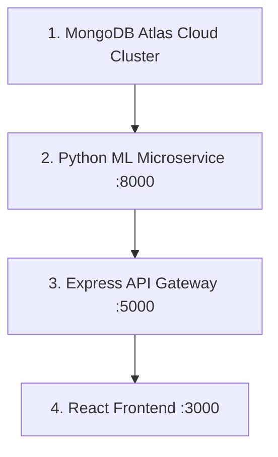

# CrimePulse 🚨

CrimePulse is an academic machine learning web platform engineered for intelligent historical crime pattern forecasting and geospatial crime trend analysis.

---

## 🎯 Architecture Overview

CrimePulse consists of three decoupled, native-process services:

1. **Python ML Microservice (`ml-service/`)**:
   - Inference-only FastAPI microservice on **port 8000**.
   - Powered by a custom pure-Python **Random Forest** classifier (300 estimators, max depth 15) trained on historical district-wise crime data.
   - Computes multi-class probability distributions across 6 major crime categories.

2. **Express API Gateway (`backend/`)**:
   - Node.js & Express REST API on **port 5000**.
   - Manages user authentication (Bcrypt hashing, JWT signing), request validation, and database persistence.
   - Connects to cloud-hosted **MongoDB Atlas** for secure multi-tenant user account and analysis record management.

3. **React Frontend (`frontend/`)**:
   - Client web application built with **React 19 + Vite** on **port 3000**.
   - Styled with Tailwind CSS and Lucide icons.
   - Provides user registration, login, route guards, prediction submission, multi-class probability progress charts, and paginated analysis history inspection.

---

## ⚙️ Prerequisites

- **Node.js**: `v18.0.0` or higher (verified on `v24.18.0`).
- **npm**: `v9.0.0` or higher.
- **Python**: `3.10`–`3.14`.
- **MongoDB Atlas**: Free Tier M0 cluster connection string.

---

## ⚡ Quick Start: Start All Services & Open Website with One Command

From the `CrimePulse` project root in Windows PowerShell:

```powershell
npm start
```
*(Or run `.\start-crimepulse.ps1` from the project root)*

This single command automatically:
1. Verifies Node.js, Python, and environment configuration files (`.env`).
2. Checks ports `8000`, `5000`, and `3000` to prevent `EADDRINUSE` conflicts.
3. Detects if any service is already running and healthy (safely reuses existing instances without spawning duplicates).
4. Launches missing services in **separate visible PowerShell terminal windows** with live log streaming:
   - **FastAPI ML Microservice**: `http://127.0.0.1:8000`
   - **Express API Gateway**: `http://127.0.0.1:5000`
   - **React + Vite Frontend**: `http://localhost:3000`
5. Polls HTTP health endpoints until all three services, the Random Forest model, and the MongoDB Atlas database connection are confirmed healthy.
6. **Automatically opens `http://localhost:3000` in your default browser**.

### Server Management Quick Reference

| Action | npm Command (Root) | PowerShell Command | What It Does |
|---|---|---|---|
| **Start All & Open Browser** | `npm start` | `.\start-crimepulse.ps1` | Starts/reuses all 3 services, verifies readiness, and opens browser |
| **Check Health & Status** | `npm run status` | `.\check-crimepulse.ps1` | Live diagnostic probe of ports, services, database, and endpoints |
| **Stop All Services** | `npm stop` | `.\stop-crimepulse.ps1` | Safely terminates only confirmed CrimePulse processes on ports 3000, 5000 & 8000 |

> **Stopping Manually**: You can also stop any individual service at any time by pressing <kbd>Ctrl</kbd>+<kbd>C</kbd> in its dedicated visible terminal window.

---

## 🛠️ Manual Step-by-Step Local Run Instructions

If you prefer to start each service in separate terminal windows manually:



---

### Step 1: Configure MongoDB Atlas & Backend Environment

1. Navigate to the `backend/` directory:
   ```bash
   cd backend
   ```
2. Copy the sample environment file:
   ```bash
   cp .env.example .env
   ```
3. Edit `backend/.env` with your settings (use safe values; never commit secrets):
   ```env
   PORT=5000
   NODE_ENV=development
   MONGODB_URI=mongodb+srv://<username>:<password>@cluster0.mongodb.net/crimepulse?retryWrites=true&w=majority
   ML_SERVICE_URL=http://127.0.0.1:8000
   JWT_SECRET=your_secure_jwt_secret_here
   JWT_EXPIRES_IN=24h
   ```
4. Install dependencies:
   ```bash
   npm install
   ```

---

### Step 2: Start the Python ML & Analytics Service (Port 8000)

1. Open a terminal in `ml-service/`:
   ```bash
   cd ml-service
   ```
2. Install Python dependencies:
   ```bash
   pip install -r api/requirements.txt
   ```
3. Start the FastAPI server using Uvicorn with auto-reload:
   ```bash
   python -m uvicorn api.main:app --reload --port 8000
   ```
4. Verify health at `http://127.0.0.1:8000/health`:
   ```json
   { "status": "ok", "service": "crimepulse-ml", "model_loaded": true }
   ```
5. Interactive API Documentation: [http://127.0.0.1:8000/docs](http://127.0.0.1:8000/docs)

---

### Step 3: Start the Express Backend Gateway (Port 5000)

1. Open a terminal in `backend/`:
   ```bash
   cd backend
   ```
2. Start the Express development server with auto-reload:
   ```bash
   npm run dev
   ```
3. Verify health at `http://127.0.0.1:5000/api/health`:
   ```json
   { "status": "ok", "service": "crimepulse-backend" }
   ```
4. Verify database health at `http://127.0.0.1:5000/api/health/db`:
   ```json
   { "status": "ok", "database": "connected" }
   ```

---

### Port Conflict Troubleshooting (`EADDRINUSE`)

If you encounter `Error: listen EADDRINUSE: address already in use` or port `3000`, `5000`, or `8000` is locked:

1. Run the safe shutdown script from the project root:
   ```powershell
   npm stop
   # or
   .\stop-crimepulse.ps1
   ```
2. Or inspect the occupying process manually in Windows PowerShell:
   ```powershell
   # Find process ID on port 5000 (or 3000 / 8000)
   Get-NetTCPConnection -LocalPort 5000 -State Listen | Select-Object OwningProcess
   # Inspect the command line to verify it belongs to CrimePulse
   Get-CimInstance Win32_Process -Filter "ProcessId = <PID>" | Select-Object ProcessId, CommandLine
   # Safely terminate only that verified CrimePulse process
   Stop-Process -Id <PID> -Force
   ```


---

### Step 4: Start the React Frontend Application (Port 3000)

1. Open a terminal in `frontend/`:
   ```bash
   cd frontend
   ```
2. Copy the frontend environment sample:
   ```bash
   cp .env.example .env
   ```
   *(Ensure `VITE_API_BASE_URL=http://localhost:5000/api`)*
3. Install frontend dependencies:
   ```bash
   npm install
   ```
4. Start the Vite development server:
   ```bash
   npm run dev
   ```
5. Open your browser at **`http://localhost:3000`**.

---

## 🧪 Automated Test Verification

Each service includes independent, automated test suites:

### 1. Frontend Test Suite (`frontend/`)
```bash
cd frontend
# Run 191 unit, mocked, and live HTTP integration tests
npm test

# Run Oxlint code quality verification
npm run lint

# Run production bundle build
npm run build
```

### 2. Backend Test Suite (`backend/`)
```bash
cd backend
# Run 244 unit and security tests
npm test

# Run 57 live end-to-end integration tests (requires running ML service & Express)
npm run test:e2e
```

### 3. Python ML Microservice Test Suite (`ml-service/`)
```bash
cd ml-service
# Run 10 FastAPI endpoint tests
python -m unittest api/tests/test_api.py

# Run 6 Random Forest model inference tests
cd crime-prediction
python -m unittest tests/test_predictor.py
```

---

## 🔒 Security & Token Persistence Architecture

- **Token Storage**: The frontend stores the issued JWT token in browser `localStorage`.
- **XSS Trade-off Notice**: `localStorage` is vulnerable to token theft if an arbitrary script execution (XSS) vulnerability exists. Token read/write logic is centralized inside `frontend/src/services/tokenService.js` to allow seamless migration to `HttpOnly`, `SameSite=Strict` cookies in future phases without altering UI components.
- **Server-Side Enforcement**: All protected endpoints (`/api/auth/me`, `/api/crime/predict`, `/api/analysis`) strictly extract ownership from verified JWT claims (`req.user._id`). The frontend never supplies a `userId` parameter.

---

## ⚖️ Responsible Use & Ethical Disclaimer

- **Classification, Not Guarantee**: CrimePulse predictions are statistical classifications generated by a Random Forest algorithm trained on historical district-wise crime records. They do not constitute a guarantee, certainty, or live incident report of future crime events.
- **Classification Confidence**: Confidence percentages represent the Random Forest decision leaf agreement for a given feature vector, not the real-world likelihood or probability of a crime occurring.
- **Non-Discriminatory Application**: Predictions are intended exclusively for academic research and spatial trend analysis. They must not be used as the sole basis for decisions regarding individuals, communities, or law enforcement profiling.
